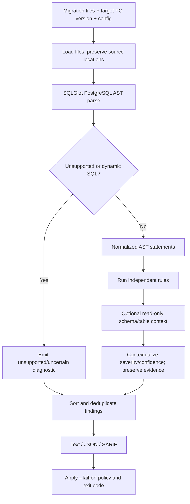

# 05 — SafeMigrate Product Specification

**Product:** SafeMigrate — Automated PostgreSQL Schema Migration Risk Analyzer  
**Status:** Proposed baseline for sign-off  
**Implementation direction:** Python package/CLI, SQLGlot AST, Typer CLI, Rich terminal reports, JSON/SARIF output

## 1. Product promise and limits

SafeMigrate statically analyzes SQL migration files before they are executed. It identifies recognized risk patterns, explains why they may be hazardous, considers supported PostgreSQL version/context information, and suggests safer approaches when justified.

It is not a proof that a migration is safe, not a SQL executor, not a replacement for staging/backup/rollback planning, and not a guarantee of zero downtime. Static analysis cannot know every workload, lock holder, data distribution, application-version dependency or provider-specific deployment constraint.

## 2. Target users and workflow

- Application engineers reviewing migration pull requests.
- Database/platform engineers maintaining PostgreSQL schemas.
- CI systems that need a predictable exit code and machine-readable findings.

Workflow: choose migration files and target PostgreSQL version → parse statements into ASTs → run dialect/version/context-aware rules → enrich with optional schema/table metadata when configured → sort/deduplicate findings → emit terminal/JSON/SARIF report → apply the configured policy threshold.

## 3. Scope and implementation order

### Required core

- PostgreSQL-only support in the initial dependable release.
- File/directory scanning and useful parse errors with file/line/statement context where available.
- SQLGlot PostgreSQL parsing, plus explicit handling for unsupported syntax/dynamic SQL rather than silent success.
- Independent rule modules with stable rule IDs and documented rationale.
- Severity, confidence, affected object, evidence, explanation and next-step suggestion.
- Deterministic JSON schema and SARIF output.
- Exit codes suitable for CI and configurable failure threshold.
- Unit/regression tests per rule and integration fixtures for parser behavior.
- Versioned rule documentation and support matrix.

### Add once the core is reliable

- Optional read-only database introspection for PostgreSQL version, table size/row estimates, indexes and constraints, using an account with minimum catalog/statistics access.
- Context-based risk adjustment and benchmark/evaluation tooling.
- Optional dashboard/API only if CLI adoption/use cases justify the operational cost.
- Additional dialects (such as MySQL) only as separate tested rule implementations after PostgreSQL stability.

## 4. Analysis pipeline



The parser is not itself the complete analyzer. Rule output should be produced from AST structure plus relevant file context, never only from `grep`/substring matches. Text matching may assist with locations or unsupported syntax, but cannot be the primary correctness mechanism.

## 5. Initial rule catalogue

Rule IDs are stable public interfaces; descriptions and behavior are versioned. Proposed starting catalogue:

| ID | Pattern / concern | Initial handling |
|---|---|---|
| `SM001` | `DROP TABLE` | High/destructive finding; name target; call out irreversible data loss unless backup/retention verified |
| `SM002` | `DROP COLUMN` | High/destructive/compatibility warning; explain data loss and old-code compatibility concern |
| `SM003` | `ALTER COLUMN TYPE` | Context-dependent warning; operation/type/version specific; never claim every type change rewrites the table |
| `SM004` | `CREATE INDEX` without `CONCURRENTLY` | Warn about possible write blocking; severity depends on table context and migration purpose; unknown size means uncertainty, not invented size |
| `SM005` | `CREATE INDEX CONCURRENTLY` in a transaction-wrapped migration | Configuration/error risk; check actual migration runner transaction behavior when known |
| `SM006` | Add `NOT NULL` or constraint that may require validation/locking | Explain staged options (nullable/add check not valid/validate/tighten) where valid for the target version |
| `SM007` | Add foreign key/check without staged validation | Warn about validation/locking implications; account for target engine/version semantics |
| `SM008` | Broad `UPDATE`/`DELETE` without a bounded predicate/batching plan | Heuristic, confidence visible; avoid asserting table-wide work if SQL semantics/context do not support it |
| `SM009` | Immediate rename/drop that may break rolling application compatibility | Requires migration/application context; otherwise say compatibility risk is unknown |
| `SM010` | Volatile/default/backfill pattern with version-specific table-impact risk | Context-aware; PostgreSQL version and expression semantics matter |
| `SM011` | Risky enum/type alteration pattern | Version/operation-specific diagnostic and caution |
| `SM012` | Potentially unsafe migration transaction or ordering pattern | Only emit when an actual configured rule and evidence support it; do not flag all transactions generically |

Initial priority should be a smaller set of high-confidence rules that can be tested deeply, then broaden. Every shipped rule must have fixtures for positive case, nearby safe case, edge case and unsupported/uncertain case.

## 6. Risk model and explanations

A finding contains:

- `rule_id`, rule title and rule version;
- severity (`critical`, `high`, `medium`, `low`, `info`);
- confidence (`high`, `medium`, `low`);
- source file, line/column/statement where available;
- affected schema/object/operation;
- evidence extracted from parsed SQL and contextual facts actually observed;
- explanation of failure mode and operational impact;
- recommended action (staged migration, explicit review, test, or contextual check);
- context used (PostgreSQL version, discovered table size, migration transaction mode) and context not known.

Severity describes potential consequence; confidence describes how strongly the rule's assumptions fit this migration. Do not hide uncertainty behind a single opaque risk score. A numeric aggregate may be added as a supplementary sort signal only if the scoring is documented, calibrated against fixtures and never presented as probability of outage.

## 7. Recommendations policy

- Recommend expand-contract for incompatible schema evolution where appropriate: add compatible new schema, deploy dual-compatible code, backfill in batches, switch reads/writes, then remove old schema in a later release.
- Use `CREATE INDEX CONCURRENTLY` only when its semantics and migration-runner transaction requirements are satisfied; it cannot be used inside a normal explicit transaction block.
- Where supported, staged constraint patterns (such as adding `NOT VALID` then validating) may reduce risk, but still need target-version/constraint-specific verification.
- Any generated SQL proposal is labelled as a suggestion, not automatically applied. Semantics-changing or data-dependent cases require human review.
- Safer migration examples include prerequisites and caveats. Never claim that every warning has a universally safe one-line fix.

## 8. CLI contract

Proposed commands:

```text
safemigrate scan migrations/
safemigrate scan db/migrations/ --pg-version 18
safemigrate scan db/migrations/ --format json --output report.json
safemigrate scan db/migrations/ --format sarif --output report.sarif --fail-on high
safemigrate rules list
safemigrate rules show SM004
safemigrate --version
```

Proposed exit codes:

- `0`: scan completed and no finding crossed configured failure threshold.
- `1`: scan completed and policy threshold was crossed.
- `2`: invalid arguments/configuration/input or migration parse/unsupported-syntax error classified as a blocking input failure.
- `3`: unexpected analyzer/runtime failure.

If parse errors and policy findings coexist, report both, but use a documented precedence rule. The CLI must not turn “could not analyze” into a green result. Exact behavior is tested and documented.

## 9. Output schema

JSON is versioned (for example, `schema_version: "1.0"`) and deterministic. Top-level fields: tool/version, scan timestamp only where non-determinism is acceptable, target engine/version, scanned files, parse/coverage diagnostics, findings, summary counts and policy decision. Findings include the fields in Section 6. File paths should be relative/redacted where appropriate so local paths/secrets are not leaked into committed artifacts.

SARIF should use stable rule IDs, locations and short/long descriptions so findings appear in compatible code-scanning surfaces. Test the emitted SARIF against a schema/consumer.

## 10. Safety and permissions

- File-only analysis is the default and requires no database credentials.
- Optional introspection is read-only, explicitly enabled and uses minimum necessary privileges; it must not execute migration SQL.
- Never mutate database schema/data, never auto-run a fix, and never connect to production by default.
- Sanitize outputs; avoid logging connection strings or secrets.
- Clearly report missing context and unsupported constructs.
- A green result means “no configured rule finding crossed policy under known assumptions,” not “migration is guaranteed safe.”

## 11. Testing and evaluation

- Unit tests for each rule's AST patterns and message fields.
- Near-miss tests: SQL that looks similar but should not trigger.
- Target PostgreSQL-version fixtures and parser compatibility tests.
- Integration tests that run selected fixture migrations on disposable PostgreSQL to validate observed behavior/constraints where feasible.
- Regression corpus with known findings; every bug adds a fixture.
- Deterministic JSON/SARIF contract tests.
- CLI exit-code tests and directory/config edge cases.
- Performance benchmark on a disclosed corpus size/statement count; report machine/runtime, files/statements, wall time and memory if measured.
- Accuracy review labels each case `expected finding`, `expected no finding`, or `unknown/context-dependent`; report false positives/negatives only for a defined labeled corpus.

## 12. Definition of done for a rule

A rule is not shipped because it recognizes one example. It needs a stable ID, explanation, severity rationale, confidence behavior, applicable versions, positive and negative fixtures, context/uncertainty fixtures, docs, output contract test, and evidence that the parser path handles its syntax. Rule changes must preserve backward compatibility or increment the documented output/rule version as needed.

## 13. SafeMigrate product acceptance criteria

- Installable from a clean environment with pinned/supported dependencies.
- Scans files deterministically and names exactly what it analyzed.
- Correctly detects all expected positives in the labeled regression corpus while documented near-misses remain unflagged (subject to known limitations in the corpus).
- Emits useful line-level reports and schema-valid JSON/SARIF.
- Exit status enforces configuration exactly.
- Unsupported syntax produces an explicit uncertain/blocking diagnostic rather than a silent pass.
- No migration SQL is executed by the analyzer.
- FlashCart CI can pin a release, produce a review artifact and apply policy without embedding FlashCart-specific logic in the rules.
- Documentation identifies blind spots, supported PostgreSQL versions and non-guarantees.
